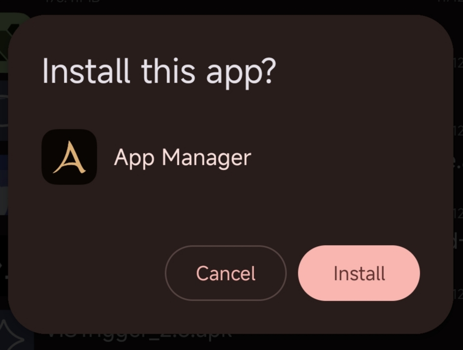

# HyperOS AOSP Installer
Replaces HyperOS's (or MIUI) default installer (global/CN) with the default AOSP android installer.

AOSP Installer on HyperOS 4 CN:

Installation:
- Grab [latest release](https://github.com/DaniTheSillyFem/HyperOS-AOSP-Installer/releases/latest)
- Install APK in Vector 2.2 or later
- Select System Framework in scope
- Reboot
- and... you're free from Ximi's bullshit :D
